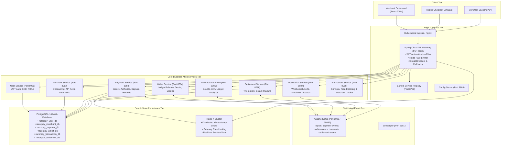
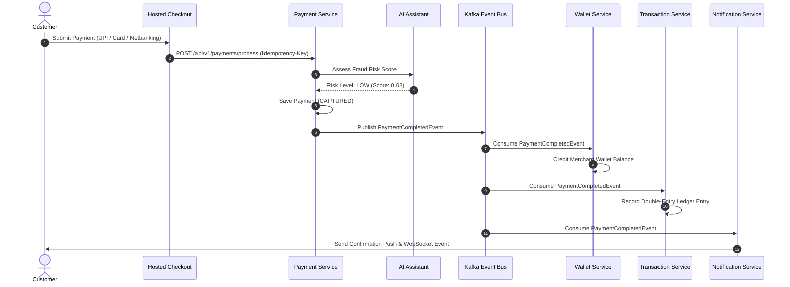

# ⚡ Razorpay Production-Grade Distributed Microservices Platform

An enterprise-grade, high-throughput distributed payment gateway system modeled after **Razorpay's core infrastructure**. Built with **Java 21**, **Spring Boot 3.3.4**, **Spring Cloud 2023**, **Apache Kafka**, **PostgreSQL**, **Redis**, and **Spring AI**, paired with a high-fidelity **React + TypeScript Merchant Dashboard**.

---

## 🏛️ System Architecture



---

## 🚀 Key Distributed System Patterns

### 1. Choreography-Based Distributed Saga
Distributed transactions avoid 2-phase locks by leveraging Kafka event choreography:


### 2. Distributed Idempotency Engine (`@Idempotent`)
- Built using **Redis distributed keys** and Spring AOP:
  ```java
  @PostMapping("/process")
  @Idempotent(keyPrefix = "payment", expireSeconds = 86400)
  public ApiResponse<PaymentDTO> processPayment(...)
  ```
- Prevents double charges, duplicate API calls from network retries, and race conditions.

### 3. Database-per-Service Isolation
- Each microservice owns its private database schema in PostgreSQL:
  - `razorpay_user_db`
  - `razorpay_merchant_db`
  - `razorpay_payment_db`
  - `razorpay_wallet_db`
  - `razorpay_transaction_db`
  - `razorpay_settlement_db`
- Eliminates tight database coupling and supports horizontal autoscaling.

### 4. Edge Security & Rate Limiting
- **Spring Cloud Gateway**:
  - Validates cryptographic HMAC SHA-256 JWT tokens.
  - Enforces Redis token-bucket rate limiting per IP and Merchant ID.
  - Resilience4j fallback circuits for graceful degradation.

### 5. Spring AI Merchant Copilot & Fraud Scoring Engine
- Real-time automated transaction scoring based on velocity, amount thresholds, and ML probability heuristics.
- Interactive merchant chatbot answering revenue analytics queries, webhook troubleshooting, and settlement summaries.

---

## 📦 Microservices Catalog & Port Allocation

| Component | Port | Technology | Primary Responsibility |
|:---|:---:|:---|:---|
| **API Gateway** | `8080` | Spring Cloud Gateway, Redis | Edge routing, JWT validation, rate limiting |
| **Service Registry** | `8761` | Netflix Eureka Server | Microservice discovery & heartbeat tracking |
| **Config Server** | `8888` | Spring Cloud Config | Centralized external configuration |
| **User Service** | `8081` | Spring Boot, JPA, PostgreSQL | User registration, authentication, RBAC |
| **Merchant Service** | `8082` | Spring Boot, JPA, PostgreSQL | Merchant onboarding, API keys, webhook configs |
| **Payment Service** | `8083` | Spring Boot, JPA, Redis, Kafka | Orders, payment processing, refunds, idempotency |
| **Wallet Service** | `8084` | Spring Boot, JPA, Kafka | Merchant/User balance management & ledger |
| **Transaction Service** | `8085` | Spring Boot, JPA, Kafka | Double-entry journal records, revenue metrics |
| **Settlement Service** | `8086` | Spring Boot, JPA, Kafka | Automated T+1 settlements, instant payout triggers |
| **Notification Service** | `8087` | Spring Boot, WebSocket, Kafka | Real-time merchant alerts & webhook dispatchers |
| **AI Assistant Service** | `8088` | Spring Boot, Spring AI, OpenAI | Transaction fraud scoring, merchant AI copilot |
| **Frontend Dashboard** | `3000` / `80` | React 18, Vite, Tailwind CSS | Merchant console & Hosted Checkout simulator |
| **PostgreSQL** | `5432` | PostgreSQL 16 Alpine | Relational storage for 6 dedicated databases |
| **Redis** | `6379` | Redis 7 Alpine | Distributed locks, idempotency cache, rate limiters |
| **Apache Kafka** | `9092` / `29092` | Confluent Kafka 7.6 | Event streaming broker |
| **Zookeeper** | `2181` | Confluent Zookeeper 7.6 | Kafka cluster coordination |
| **Zipkin** | `9411` | OpenZipkin 3 | Distributed distributed tracing & telemetry |

---

## 🛠️ Quickstart Guide

### Option 1: Run with Docker Compose (Recommended)

1. **Build all JARs and launch the entire platform**:
   ```bash
   # On Windows:
   docker-build.bat
   docker compose up -d

   # On Linux/macOS:
   chmod +x docker-build.sh
   ./docker-build.sh
   docker compose up -d
   ```

2. **Access the Web Services**:
   - **Merchant Dashboard**: [http://localhost:3000](http://localhost:3000)
   - **API Gateway**: [http://localhost:8080](http://localhost:8080)
   - **Eureka Service Registry**: [http://localhost:8761](http://localhost:8761)
   - **Zipkin Tracing**: [http://localhost:9411](http://localhost:9411)

---

### Option 2: Run with Kubernetes (K8s)

All manifests in `k8s/` are pre-configured for Minikube, Kind, or production clusters (EKS/GKE):

```bash
# Apply all Kubernetes manifests in sequence:
# On Windows:
k8s-deploy.bat

# On Linux/macOS:
chmod +x k8s-deploy.sh
./k8s-deploy.sh
```

Manifests included in `k8s/`:
- `00-namespace.yml` (Dedicated `razorpay-system` namespace)
- `01-configmaps-secrets.yml` (Common configs, secrets, DB init SQL)
- `02-databases.yml` (PostgreSQL StatefulSet with auto-init & Redis)
- `03-kafka.yml` (Zookeeper & Apache Kafka Broker)
- `04-service-registry.yml` (Eureka cluster)
- `05-api-gateway.yml` (Spring Cloud Gateway)
- `06-microservices.yml` (All 9 core microservices + HPAs)
- `07-ingress.yml` (Nginx Ingress controller rules)
- `08-frontend.yml` (React Dashboard Deployment & Service)

---

### Option 3: Local Development (IDE / CLI)

1. **Start Infrastructure Containers** (PostgreSQL, Redis, Kafka, Zookeeper, Zipkin):
   ```bash
   docker compose -f docker-compose.infra.yml up -d
   ```

2. **Launch All Services with 1-Click Script**:
   ```bash
   # On Windows:
   .\run-local.bat

   # On Linux/macOS:
   chmod +x run-local.sh stop-local.sh
   ./run-local.sh
   ```
   *(To stop all local services, simply run `.\stop-local.bat` on Windows or `./stop-local.sh` on Linux/macOS).*

3. **Or Start Services Manually in Separate Terminals**:
   ```bash
   # Build all JARs:
   mvn clean package -DskipTests

   # Terminal 1: Service Registry (Eureka on :8761)
   java -jar service-registry/target/service-registry-1.0.0.jar

   # Terminal 2: API Gateway (:8080)
   java -jar api-gateway/target/api-gateway-1.0.0.jar

   # Terminal 3: Core Microservices (:8081 through :8088)
   java -jar user-service/target/user-service-1.0.0.jar
   java -jar merchant-service/target/merchant-service-1.0.0.jar
   java -jar payment-service/target/payment-service-1.0.0.jar
   java -jar wallet-service/target/wallet-service-1.0.0.jar
   java -jar transaction-service/target/transaction-service-1.0.0.jar
   java -jar settlement-service/target/settlement-service-1.0.0.jar
   java -jar notification-service/target/notification-service-1.0.0.jar
   java -jar ai-assistant-service/target/ai-assistant-service-1.0.0.jar

   # Terminal 4: Frontend Dashboard (:3000)
   cd razorpay-frontend
   npm run dev
   ```

---

## 📡 API Reference & cURL Testing Walkthrough

### 1. Register & Authenticate User
```bash
# Register
curl -X POST http://localhost:8080/api/v1/auth/register \
  -H "Content-Type: application/json" \
  -d '{
    "fullName": "Rohit Sharma",
    "email": "rohit.sharma@example.com",
    "password": "Password123!",
    "phone": "+919876543210"
  }'

# Login to receive JWT Token
curl -X POST http://localhost:8080/api/v1/auth/login \
  -H "Content-Type: application/json" \
  -d '{
    "email": "rohit.sharma@example.com",
    "password": "Password123!"
  }'
```

### 2. Create an Order
```bash
curl -X POST http://localhost:8080/api/v1/orders \
  -H "Content-Type: application/json" \
  -H "Authorization: Bearer <YOUR_JWT_TOKEN>" \
  -H "X-Merchant-Id: 11111111-1111-1111-1111-111111111111" \
  -d '{
    "amount": 2499.00,
    "currency": "INR",
    "description": "Premium Pro Subscription"
  }'
```

### 3. Process an Idempotent Payment
```bash
curl -X POST http://localhost:8080/api/v1/payments/process \
  -H "Content-Type: application/json" \
  -H "Authorization: Bearer <YOUR_JWT_TOKEN>" \
  -H "Idempotency-Key: idemp_order_9921_attempt_1" \
  -H "X-Merchant-Id: 11111111-1111-1111-1111-111111111111" \
  -d '{
    "orderId": "order_O8vB7cT3xY44",
    "amount": 2499.00,
    "method": "UPI",
    "vpa": "rohit@okhdfcbank",
    "customerEmail": "rohit.sharma@example.com",
    "customerPhone": "+919876543210"
  }'
```

### 4. Initiate a Refund
```bash
curl -X POST http://localhost:8080/api/v1/payments/pay_P9aK8mN2vX11/refund \
  -H "Content-Type: application/json" \
  -H "Authorization: Bearer <YOUR_JWT_TOKEN>" \
  -d '{
    "amount": 2499.00,
    "reason": "Customer cancellation within 24h window"
  }'
```

### 5. Trigger Instant Merchant Settlement
```bash
curl -X POST http://localhost:8080/api/v1/settlements/trigger \
  -H "Content-Type: application/json" \
  -H "Authorization: Bearer <YOUR_JWT_TOKEN>" \
  -H "X-Merchant-Id: 11111111-1111-1111-1111-111111111111" \
  -d '{
    "amount": 75000.00
  }'
```

### 6. Query AI Copilot & Insights
```bash
# Get merchant financial summary & anomaly detection:
curl -X GET http://localhost:8080/api/v1/ai/insights \
  -H "Authorization: Bearer <YOUR_JWT_TOKEN>"

# Ask Copilot a natural language question:
curl -X POST http://localhost:8080/api/v1/ai/chat \
  -H "Content-Type: application/json" \
  -H "Authorization: Bearer <YOUR_JWT_TOKEN>" \
  -d '{
    "message": "How do I verify webhook signatures in Python?"
  }'
```

---

## 💻 Merchant Console Features

- **📊 Live Overview Dashboard**: Volume metrics, success rates, UPI vs. Card breakdown, and 7-day revenue trends.
- **💳 Hosted Checkout Simulator**: Interactive real-time payment experience testing UPI QR, Card 3DS, and Netbanking flows.
- **📋 Transactions & Instant Refunds**: Searchable payment records with instant refund triggers.
- **🏦 Automated Settlements**: View settled batches, net payout amounts, deducted fees/GST, and trigger instant settlements.
- **🔑 Developer Tools**: Live API key generation (`rzp_live_...` / `rzp_test_...`) and Webhook endpoint subscriptions.
- **🤖 Floating AI Copilot**: Slide-out assistant for real-time risk checks, integration troubleshooting, and natural language analytics.

---

## 🛡️ License
Designed for production-grade distributed fintech architectures. Distributed under the Apache 2.0 License.
